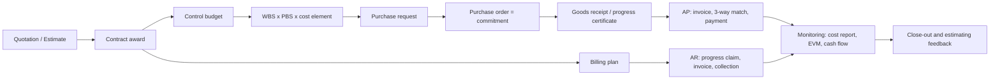

# EPC Budget Workflow

How budget is created, committed, spent, billed and monitored in an Engineering, Procurement and Construction (EPC) project, from quotation to close-out.

Every rupiah should be traceable through one chain:

```
COST SIDE
Estimate ─► Contract price ─► Control budget ─► Commitment (PO) ─► Actual (AP) ─► Payment
                 │                  │
                 │          broken down by WBS × PBS × cost element
                 ▼
REVENUE SIDE
Contract value ─► Billing plan ─► Progress claim / invoice (AR) ─► Collection

MONITORING: budget vs commitment vs actual vs forecast (EAC), earned value, cash flow
```



---

## 1. Quotation (estimating and bidding)

**Goal:** turn the client's scope into a price you can defend, with the risks costed.

1. **Read the scope.** Go through the invitation to bid, specs, drawings, contract terms, payment terms and liquidated damages, and log clarifications and exclusions.
2. **Build the estimate bottom-up:**
   - **Engineering:** man-hours per deliverable × rates.
   - **Procurement:** equipment from vendor quotes, bulk materials from material take-offs (MTO), freight, duties.
   - **Construction:** labour hours × productivity × rates, plus equipment and subcontracts.
   - **Indirects:** site overhead, temporary facilities, insurance, bonds, financing.
   - **Escalation and foreign-exchange exposure.**
3. **Cost the risk.** Use a risk register to set **contingency** for known unknowns, then add **margin**.
4. **Map to the client's format.** The internal estimate is coded by WBS and cost element, but the price goes to the client in their bid schedule or pay-item format. Keep a cross-reference between the two.
5. **Get approval.** Run bid/no-bid and tender review against the delegation-of-authority matrix, then submit.

**Output:** the priced quotation plus a **frozen estimate baseline**.

## 2. Contract award and the internal budget

1. **Tender-to-contract reconciliation:** compare the negotiated price with the estimate. Find where margin or contingency was given away and which scope changed.
2. **Original Control Budget (OCB):** split the contract value into:
   - **Cost budget** per control account, which project managers spend against.
   - **Project contingency**, held by the project manager and drawn down through a log.
   - **Management reserve**, held by corporate and not in the project's budget.
   - **Margin**.
3. **Time-phase the budget** against the schedule to get the **cost baseline (S-curve)** and the **cash-flow forecast**: when you pay versus when you get paid.
4. **Load it into the ERP** (SAP PS, Oracle, etc.) as WBS elements or cost codes with budgets, and switch on **availability control** so you can't commit more than the budget.

## 3. The coding backbone: WBS, PBS and cost elements

These structures answer different questions. Together they make the cost code.

| Structure | Answers | Example (process plant) | Example (shipbuilding) |
|---|---|---|---|
| **PBS**: product breakdown structure | *What* is being built | Plant → Unit → System → Equipment tag | Ship → Block / SWBS group → System → Item |
| **WBS**: work breakdown structure | *What work* delivers it, and who is responsible | Project → E / P / C / Commissioning → Area → Discipline → Work package | Design → Procurement → Hull fabrication → Outfitting → Testing |
| **CBS / cost element** | *What kind* of cost | Labour, material, equipment, subcontract, indirect | Same |
| **OBS**: organisation breakdown structure | *Who* owns it | Engineering manager, procurement manager, construction manager | Same |

- **Control account** = a WBS element × an OBS owner. It is the level where budget, schedule and progress are managed and reported.
- **Work package** = the lowest level of the WBS. Each has a budget, dates and a **progress-measurement method**: weighted milestones, units installed, or % complete for level-of-effort work.
- **Why PBS matters:**
  - Engineering MTOs and material requisitions are generated per PBS item.
  - Commissioning is done by system.
  - Final cost per system or block feeds back into the estimating database for the next bid.
- **Typical cost code:** `WBS.Area.Discipline` + `PBS tag/system` + `cost element`, for example `C.U200.PIP / U200-P-101 / MAT`.
- **Where it leads:** the WBS gives every purchase its budget home and its need date; the PBS gives it its quantity basis. Section 4 shows how each PR line inherits both.

## 4. Purchase request (PR) to purchase order (PO)

### 4.1 The interlock with WBS × PBS

A PR is not typed from scratch. Each PR line is created from an MTO line, and the MTO line already belongs to a PBS item inside a WBS work package. The code travels unchanged through the PO, the goods receipt and the invoice. That is why commitments and actuals land on the same line as the budget, and why the cost report in section 7 can compare them.

| Document | Code it carries | What it updates |
|---|---|---|
| Control budget | `C.U200.PIP` (WBS control account) | Budget |
| MTO line | `C.U200.PIP / U200-P-101` | Required quantity per PBS item |
| PR line | `C.U200.PIP / U200-P-101 / MAT` (inherited + cost element) | Pre-commitment (in ERPs configured for it) |
| PO line | Same code, copied from the PR line | Commitment |
| Goods receipt | Same code, against PO line and PBS tag | Material status per tag; accrual |
| Invoice | Same code, matched to PO + GR | Actual cost |
| Cost report | Rolls up by WBS, drills down by PBS | Budget vs committed vs actual vs EAC |

**Three checks every PR line must pass.** Example line: `PR-26-0412 / 10`, pipe 6" SCH40 CS A106-B, 300 m, Rp 0.45 bn, WBS `C.U200.PIP`, PBS `U200-P-101`, cost element `MAT`, required on site 15 Mar 2027. *(Example figures.)*

| Check | Structure | Question | Example | Result |
|---|---|---|---|---|
| **Budget** | WBS control account | Is there money left? | Budget 18.40, committed 17.20, remaining 1.20; line 0.45 (Rp bn) | Pass: 0.75 left |
| **Quantity** | PBS item MTO | Is the quantity within what engineering says this item needs? | MTO rev C 1,240 m, already on PR/PO 980 m, balance 260 m; line 300 m | Hold: 40 m over; revise the MTO or justify as surplus allowance |
| **Timing** | WBS schedule | Will it arrive before the work package needs it? | PR 7 Oct 2026 + 6 wk award + 14 wk lead time = 24 Feb 2027; needed 15 Mar 2027 | Pass: about 3 weeks of float |

The budget check uses money at WBS level; the quantity check uses physical quantity at PBS level. A PR can pass one and fail the other, which is why both are needed.

**How the structures map in practice:**

| Situation | How the interlock handles it |
|---|---|
| **One PO, many PBS items** | A pipe or valve package buys for dozens of tags. Each PO line (or split account assignment) keeps its own WBS + PBS code, so the commitment is spread to the right accounts. |
| **One work package, many POs** | A piping work package draws material from several procurement packages. The cost report rolls them up by WBS; material status rolls up by PBS. |
| **Procurement packages** | Buyers group MTO lines by commodity (pipe, valves, steel, cable) into packages for RFQ. The package is the buying unit; the WBS × PBS code on each line is still the costing unit. |
| **Bulk and stock material** | Bought to a warehouse against an area or discipline WBS, then issued to a work package and PBS item. Cost moves to the work package at issue, not at purchase. |
| **Engineering revision** | A new MTO revision changes the required quantity per PBS item. The difference becomes a delta PR (shortage) or a surplus. Quantity growth above the estimate is logged as a trend (section 7). |
| **Free-issue to subcontractors** | Material issued to a subcontractor stays coded to the PBS item, so installed quantity can be reconciled against what was issued. |

**Rule:** no PR line without a WBS element and a PBS item. If engineering hasn't produced an MTO line for it, the request has no quantity basis and no budget home. That points to a scope or estimate gap to resolve first.

### 4.2 From PR to commitment

```
Engineering MTO / spec (qty per PBS item, inside a WBS work package)
   ─► Material Requisition (technical)
   ─► Purchase Request in the ERP (each line inherits WBS × PBS code + cost element + value)
   ─► Budget, quantity and timing checks (WBS money, PBS MTO balance, required-on-site date)
   ─► RFQ to shortlisted vendors ─► Technical + commercial bid evaluation
   ─► Award approval (delegation of authority by value)
   ─► Purchase order / subcontract  =  COMMITMENT
```

- **Checks at the PR:** if a line fails the budget, quantity or timing check, it goes to a budget transfer, a contingency drawdown, an MTO revision or a change request. You don't just raise the PO anyway.
- **The PO is a commitment.** It reduces available budget immediately, even before any invoice. Commitment tracking gives you early warning, because roughly 60–70% of EPC cost is locked in by POs and subcontracts.
- **Delivery and receipt:**
  - **Materials:** expediting, inspection and test plans, factory acceptance tests, then **goods receipt (GR)** at site.
  - **Services and subcontracts:** a **service entry sheet** or **progress certificate** instead of a GR.
- **Vendor advance payments** are made only against an advance-payment bank guarantee and recovered from later invoices.

## 5. Accounts payable (AP) control

1. The vendor submits an invoice.
2. **Three-way match:** PO (price and quantity) = GR or service entry sheet (received) = invoice (billed). Any mismatch is held.
3. The invoice is approved per the delegation of authority and posted as an **actual cost** to the cost code.
4. **Deductions:** retention on subcontractors (typically 5–10%), advance-payment recovery, withholding tax (PPh 23 / PPh 4(2) for construction services), and VAT (PPN) handling.
5. Payment is made per the payment terms and scheduled to match cash coming in from the client.
6. **Accruals:** goods received but not yet invoiced are accrued, so actual costs aren't understated at month-end.

**Key controls:**

- No PO without a PR.
- No payment without a GR or certificate.
- No PO raised after the work has already started (an "after-the-fact" PO).
- Segregation of duties: the person who requests is not the person who approves or pays.

## 6. Accounts receivable (AR) control

Billing follows the contract's payment mechanism:

| Billing element | How it works |
|---|---|
| **Advance payment** | Usually 10–20%, issued against an advance-payment bond and recovered pro-rata from each claim |
| **Milestone billing** | Paid on defined events, e.g. design approval, equipment delivery, mechanical completion |
| **Progress billing** | A monthly progress claim based on measured progress, certified by the client or engineer |
| **Retention** | 5–10% withheld from each claim; half is often released at handover and the rest after the defects liability period |
| **Variation orders (VOs)** | Billed only after formal approval, so chase approvals quickly |
| **Claims** | Disputed extra costs or extensions of time, tracked separately |

**AR monitoring:**

- **Ageing and days sales outstanding (DSO).**
- **Unbilled work:** work done but not yet claimed shows up as a *contract asset* under PSAK 72 / IFRS 15.
- **Billing in excess:** billed ahead of progress is a *contract liability*.
- **Revenue recognition:** usually over time, using cost-to-cost % complete.
- **Cash:** aim to keep the project **cash-positive**, with collections running ahead of AP payments. Front-loaded milestones help.

## 7. Monitoring and managing the budget

### Monthly cost report (per control account and project total)

| Original budget | + Approved changes | = Current budget | Committed (POs) | Actual (incurred) | Estimate to complete (ETC) | Estimate at completion (EAC) | Variance (Budget − EAC) |
|---|---|---|---|---|---|---|---|

### Earned value

- **PV** = planned value (budgeted cost of work scheduled).
- **EV** = earned value (budget × physical % complete).
- **AC** = actual cost.
- **CPI = EV / AC.** Below 1 means over budget.
- **SPI = EV / PV.** Below 1 means behind schedule.
- **EAC** = AC + (Budget − EV) / CPI, as a sanity check against the bottom-up forecast.

### Change management

| Type of change | Effect on revenue | Effect on budget |
|---|---|---|
| **Client-driven scope change** | Increases through a VO | Increases |
| **Internal trend** (design growth, productivity loss, price escalation) | None | Goes through the trend register, then a contingency drawdown or budget transfer |
| **Contingency log** | — | Drawdowns are tracked against the risks that were retired; unused contingency at the end flows back to margin |

### Cash-flow tracking

Track actual collections against payments, and compare with the cash forecast prepared at award.

## 8. Close-out

- **Contracts:** close out all POs and subcontracts and agree final accounts with vendors.
- **Money:** collect final retention, release bonds, and settle open claims and VOs.
- **Reconciliation:** check final cost against the estimate per PBS item and WBS element.
- **Feedback:** feed actual unit rates, productivity and lessons learned back into the **estimating database**, so the next quotation is better.

---

## Where EPC projects usually lose control

1. The estimate is coded differently from the control budget, so you can't compare like with like.
2. Only actual costs are tracked, not commitments, so the overrun shows up months late.
3. POs are raised after the work has started, which bypasses the budget check.
4. Unapproved VOs: the work is done but can't be billed.
5. Progress is measured subjectively, which inflates EV and hides CPI problems.
6. Billing and payment terms are mismatched, so the project runs cash-negative.
