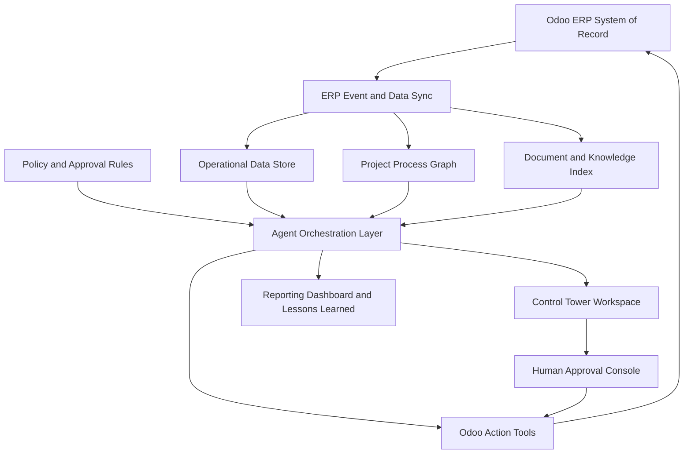

# Agentic AI Control Tower for Odoo-Based ERP Operations

Architecture, Design, and Product Design Requirements  
Prepared in a consulting-style report format  
Date: 2026-10-13  
Source: `DRAFT FLOWCHART REV FINAL 6.pdf`

## Important Note

This document is written in a professional consulting report style inspired by common executive advisory deliverables. It does not use any proprietary KPMG templates, marks, logos, copyrighted content, or confidential methodology.

## 1. Executive Summary

The source flowchart defines an end-to-end enterprise operating model from strategic planning through project delivery and final evaluation. The process spans BOD/shareholders, corporate planning, marketing and sales, legal, project management, production, design, quality assurance, IT, SEWACO, supply chain, risk management, treasury, accounting, HR, and structured financing.

The proposed solution is an Agentic AI Control Tower built on top of the existing Odoo ERP. Odoo remains the system of record. The control tower adds an intelligent operating layer that monitors cross-functional process status, detects exceptions, prepares evidence-based recommendations, orchestrates handoffs, supports approvals, and captures lessons learned.

The primary business case is not automation for its own sake. The value is improved execution control across complex project operations: fewer delayed handoffs, better project-code discipline, faster billing readiness, improved procurement visibility, stronger QA gate control, more reliable AP/AR and cash visibility, and a closed loop from project lessons back into future planning.

## 2. Key Messages for Leadership

| Key message | Implication |
|---|---|
| The flowchart is a project-centric operating model, not only a process diagram | The control tower should be organized around a project digital thread from opportunity/tender through delivery and lessons learned |
| Odoo contains the transaction base but not the full operational intelligence layer | A separate control tower layer is required for process graph, exception logic, agent orchestration, and decision evidence |
| AI should support decisions before it executes transactions | High-impact actions such as PO confirmation, payment, invoicing, QA override, and contract approval must remain human-approved |
| Data linkage is the critical foundation | Project code, WBS/CBS/PBS/BOQ, PR/PO, material issue, QA gate, invoice, payment, and lessons learned must be linked consistently |
| MVP should focus on daily execution control | Start with project control, supply chain, production, quality, finance, and lessons learned before expanding to strategy and tender optimization |

## 3. Current State Interpretation

### 3.1 Flowchart Phases

The source process is structured across five operating phases:

| Phase | Business purpose | Representative outputs |
|---|---|---|
| Strategic foundation and development | Translate corporate direction into policy, planning, capacity, funding, and operating guidelines | Corporate target, sales and marketing plan, production capacity, IT strategy, QA plan, supply chain policy, funding plan, accounting policy, HR plan |
| Strategic planning system creation | Prepare project feasibility, work breakdown, cost breakdown, risk analysis, financing analysis, and proposal | Project initiate, WBS/CBS, PBS, feasibility project/proposal, selling base price, risk analysis, financing analysis |
| Contract and project setup | Convert approved commercial opportunity into an executable project baseline | Contract signing, project code, project management plan, master schedule, IPP, cash flow plan, ERP project management setup |
| Pre-production | Release design, production, material, budget, procurement, and payment prerequisites | Production planning and work package, JO production, JO design, product data management, PR, procurement plan, PO, payment |
| Production and final evaluation | Execute production, quality acceptance, billing, delivery, financial closure, and lessons learned | Material issue, fabrication stages, HAT/SAT, progress billing, payment, P&L, delivery, final report, lessons learned |

### 3.2 Observed Operating Challenges

| Observation | Potential impact | Control tower response |
|---|---|---|
| Many process steps depend on cross-directorate handoffs | Delays may be visible late, after procurement, production, or billing impact has occurred | Create event-driven handoff monitoring and aging alerts |
| Project code is central to financial, operational, and reporting integrity | Transactions without project linkage reduce visibility of cost, material, QA, AP/AR, and profitability | Enforce project digital thread completeness checks |
| Procurement, production, QA, finance, and risk are highly interdependent | Local optimization can create enterprise-level execution failures | Use multi-domain exception scoring and escalation |
| Billing and payment are downstream of operational evidence | Missing acceptance records or unclear contract milestone linkage delays cash conversion | Generate billing readiness and payment readiness packets |
| Lessons learned appear at final evaluation but should inform future planning | Knowledge may be captured too late or not translated into database updates | Capture lessons during execution and route them to target databases |

## 4. Strategic Design Recommendation

### 4.1 Recommended Target State

Establish an Agentic AI Control Tower as a governed intelligence layer connected to Odoo. The target state has four core capabilities:

1. Project digital thread: a persistent graph linking strategic target, tender, contract, project code, PMP, WBS/CBS/PBS/BOQ, design, procurement, material, production, quality, finance, risk, and lessons learned.
2. Exception management: daily detection, prioritization, ownership, SLA tracking, escalation, and resolution of operational exceptions.
3. Decision intelligence: evidence-based approval packets for controlled ERP actions, including risk, policy, source records, and recommended options.
4. Learning loop: structured capture of project lessons into cost, customer, vendor, material, productivity, engineering, procurement, and planning databases.

### 4.2 Design Principles

| Principle | Design implication |
|---|---|
| Odoo is the system of record | The control tower reads, recommends, drafts, and escalates; approved writes return to Odoo |
| Process state is event-driven | ERP changes trigger agent assessment instead of waiting for manual reporting cycles |
| Human authority is preserved | High-impact transactions require approval based on a delegation of authority matrix |
| Recommendations must be explainable | Every recommendation includes source records, documents, assumptions, confidence, and risk |
| Data quality is a control objective | Missing project code, missing work package, missing QA evidence, and missing contract milestone links are treated as exceptions |
| Lessons learned are operational assets | Project knowledge is captured, classified, and routed to reusable enterprise databases |

## 5. Target Operating Model

### 5.1 Control Tower Role in Daily Operations

The control tower should function as the operational nerve center for daily ERP execution. It should not be positioned as a chatbot or reporting add-on. Its role is to coordinate the operating rhythm across PMT, production, design, QA, supply chain, finance, risk, and leadership.

| Operating layer | Purpose | Example outputs |
|---|---|---|
| Observe | Monitor Odoo events, documents, schedules, risks, inventory, QA, invoices, and payments | Refreshed project digital thread |
| Assess | Identify exceptions, missing links, variance, overdue handoffs, and decision needs | Exception queue and health score |
| Recommend | Provide evidence-based action options | Recommended owner, action, due date, evidence |
| Orchestrate | Route tasks and approvals across directorates | Odoo activities, approval packets, escalation notes |
| Learn | Capture outcome and reusable knowledge | Lessons learned and database update recommendations |

### 5.2 Daily Management Rhythm

| Time window | Activity | Output |
|---|---|---|
| 05:00-06:00 | Sync Odoo changes, refresh graph, refresh metrics and documents | Updated operational state |
| 06:00-07:00 | Agents scan schedule, procurement, production, QA, risk, AP, AR, cash, and data completeness | Ranked exceptions |
| 07:00-08:00 | Generate role-based daily brief | Executive, PMT, finance, supply chain, production, QA, and risk briefs |
| 08:00-10:00 | War room triage | Confirmed owners, due dates, escalations, approvals |
| 10:00-15:00 | Agent-assisted execution | Draft actions, approval packets, evidence packs |
| 15:00-16:00 | Reforecast progress and cash | Updated S-curve, procurement risk, AP/AR and cash view |
| 16:00-17:00 | Capture decisions and lessons | Decision log and knowledge updates |

### 5.3 Role-Based Views

| View | Audience | Decision supported |
|---|---|---|
| Executive portfolio view | BOD and directors | Which projects threaten strategic, financial, or operational targets? |
| PMT control room | PMT and project managers | What must be resolved today to protect schedule, cost, quality, and cash? |
| Project digital thread | Cross-functional project team | What records, evidence, and handoffs are connected to this project? |
| Supply chain cockpit | Supply chain, PMT, finance | Which materials, POs, suppliers, or payments threaten production? |
| Production cockpit | Production, QA, PMT | Which work packages are blocked by material, labor, design, or QA gates? |
| Finance cockpit | Treasury, accounting, PMT | Which AP, AR, billing, payment, or P&L issues need action? |
| Approval console | Authorized approvers | What decision is required, what evidence supports it, and what is the risk? |
| Lessons learned workspace | PMT and knowledge owners | What reusable insight should update enterprise databases? |

## 6. Reference Architecture

### 6.1 Architecture Overview

### 6.2 Architecture Components

| Component | Purpose | Recommended implementation |
|---|---|---|
| Odoo connector | Read/write integration with ERP records and workflows | Odoo custom module using ORM where possible; API boundary for external components |
| Event log | Immutable timeline of ERP and process events | PostgreSQL table or analytical schema with event type, model, record, actor, project code, timestamp |
| Process graph | Represents project digital thread and cross-functional dependencies | Graph model over project, WBS, PBS, BOQ, PR, PO, material, QA, invoice, payment, risk, decision, document |
| Knowledge index | Retrieval over contracts, tender documents, policies, QA records, engineering documents, vendor history, and lessons | Vector index with role-aware retrieval and source citation |
| Metrics store | Health indicators and trend metrics | Project health, schedule variance, cost variance, procurement risk, QA status, AP/AR, cash |
| Rules engine | Policy, delegation of authority, thresholds, and exception rules | Configurable rules table plus deterministic workflow checks |
| Agent runtime | Coordinates agents, tools, retries, approvals, and audit | Agent orchestrator with tool registry, permissioning, state machine, and idempotency |
| Control tower UI | Daily workspace and dashboards | Odoo backend views plus optional embedded web application |
| Audit layer | Traceability of agent actions and approvals | Append-only log of context, recommendation, approval, action, and result |

### 6.3 Data Flow

1. Odoo records and documents are synchronized into the event log, graph, metrics store, and knowledge index.
2. Rules and agents evaluate the current state against process expectations and control thresholds.
3. Exceptions are created with severity, owner, SLA, evidence, and recommended action.
4. For controlled actions, agents prepare an approval packet rather than executing directly.
5. Human approvers review evidence and approve, reject, or request revision.
6. Approved actions are written back to Odoo through controlled tools.
7. Outcomes are captured in the audit log and lessons learned repository.

## 7. Agentic System Design

### 7.1 Agent Portfolio

| Agent | Business scope | Core responsibilities | Autonomy level |
|---|---|---|---|
| Control Tower Orchestrator | All phases | Trigger agents, consolidate daily brief, resolve conflicts, route approvals | Recommend and coordinate |
| Strategy Alignment Agent | RKAP/RJPP, corporate target, integrated master schedule | Compare portfolio execution to strategic targets and capacity constraints | Recommend |
| Tender and Proposal Agent | Project initiate, feasibility, proposal, selling base price | Validate tender completeness, feasibility evidence, risk and financing readiness | Recommend and draft |
| Legal and Contract Agent | Legal review, contract signing, license, obligation register | Extract obligations, identify missing reviews, connect contract to project baseline | Recommend and draft |
| Project Control Agent | PMP, master schedule, S-curve, project management control | Monitor schedule, cost, progress, risk, and quality variance | Recommend and draft |
| Design and Product Data Agent | Design, BOQ, PBS, maker list, JO design, product data | Validate design release, BOQ/PBS consistency, change impact | Recommend and draft |
| Supply Chain Agent | Procurement plan, PR, PO, material, vendor, subcontracting | Detect material delay, lead time risk, vendor risk, PO/payment dependency | Recommend and draft |
| Production Control Agent | JO production, material issue, production stages | Monitor work package readiness, labor/material consumption, bottlenecks | Recommend and draft |
| Quality Agent | QA plan, TPTR, in-process quality, HAT/SAT | Check QA evidence, failed gates, acceptance readiness | Recommend and draft |
| Finance and Cash Agent | Budget, AP, AR, payment, billing, P&L | Monitor cash, billing readiness, payment blockers, profitability variance | Recommend and draft |
| Risk and Compliance Agent | Risk analysis, business control, compliance review | Maintain risk register, detect compliance exceptions, escalate risk | Recommend and draft |
| HR and Resource Agent | Human capital planning, resources, competency | Identify resource gaps and competency constraints | Recommend |
| Lessons Learned Agent | Final report, databases, reporting dashboard | Capture lessons and recommend database updates | Recommend and draft |

### 7.2 Agent Operating Pattern

Each agent follows a controlled pattern:

1. Observe relevant ERP events and scheduled triggers.
2. Retrieve linked records, documents, policies, process graph neighbors, and prior decisions.
3. Assess variance, missing data, risk, blocker, or approval need.
4. Produce a recommendation with evidence and confidence.
5. Draft actions or approval packets within permitted scope.
6. Escalate controlled actions to the responsible human approver.
7. Record outcome and learning.

### 7.3 Human-in-the-Loop Control Model

| Action type | Agent role | Human role |
|---|---|---|
| Create observation or exception | Create automatically with evidence | Review or resolve |
| Create task/activity | Draft or create under configured rules | Accept, reassign, or close |
| Update forecast or risk narrative | Draft recommendation | Approve before finalization if material |
| Confirm PO or vendor award | Prepare decision packet | Approve and execute |
| Release payment | Prepare payment readiness packet | Approve and execute |
| Post invoice or progress billing | Prepare billing readiness packet | Approve and post |
| Override QA gate | Prepare exception packet | Approve by authorized role |
| Change project baseline | Prepare impact analysis | Approve through governance |
| Sign contract or amendment | Prepare obligation and risk analysis | Approve and sign outside autonomous scope |

## 8. Odoo Solution Design

### 8.1 Core Odoo Anchors

| Business object | Odoo anchor | Control tower role |
|---|---|---|
| Corporate target and RKAP/RJPP | Planning, budgets, analytic accounts, custom strategy model | Top-level objective and constraint |
| Opportunity, tender, project initiate | CRM, Sales, Documents, Project | Requirement and feasibility evidence |
| Contract | Sales order, contract/custom model, documents, approvals | Commercial obligation and baseline trigger |
| Project code | Project, analytic account, sequence | Digital thread identifier |
| PMP, master schedule, S-curve | Project, Planning, milestones, custom baseline model | Execution baseline |
| WBS/CBS/PBS/BOQ | Project tasks, analytic tags, BOM/product, custom breakdown model | Scope, cost, procurement, and production structure |
| JO production and JO design | Manufacturing/work orders or custom job order models | Execution release and accountability |
| PR, PO, procurement plan | Purchase, Inventory, Approvals | Material and service acquisition |
| Material inventory and issue | Inventory, stock moves, lots/serials | Material availability and consumption |
| QA records, HAT/SAT | Quality, Documents, custom acceptance models | Gate control and acceptance evidence |
| AP, AR, progress billing, payment | Accounting, Invoicing, Payments | Cash, billing, payables, profitability |
| Lessons learned | Knowledge, Documents, custom lesson model | Reusable enterprise knowledge |

### 8.2 Minimum Custom Objects

| Object | Purpose | Key fields |
|---|---|---|
| `control_tower.event` | Immutable event log | model, record_id, project_code, event_type, actor, timestamp |
| `control_tower.exception` | Exception lifecycle | severity, owner, SLA, status, evidence, linked_records |
| `control_tower.decision` | Decision and approval audit | approver, authority_rule, recommendation, evidence, outcome |
| `control_tower.process_node` | Digital thread node | node_type, linked_model, linked_record, project_code, dependencies |
| `project.baseline` | Approved schedule, cost, and cash baseline | version, effective_date, approved_by, schedule_ref, budget_ref |
| `project.risk` | Project risk register | probability, impact, mitigation, owner, status |
| `project.lesson` | Lessons learned | category, source_project, recommendation, target_database, approval_status |
| `engineering.product_data_issue` | Design and BOQ/PBS data exception | design_ref, BOQ_ref, material_ref, severity, resolution |

### 8.3 Data Quality Controls

| Control | Severity | Example exception |
|---|---|---|
| Project code required on execution transactions | Critical | PO exists without project code |
| PR/PO linked to BOQ/PBS/work package where applicable | High | Material procurement cannot be traced to scope |
| Material issue linked to work package and production stage | High | Material consumed without production accountability |
| QA gate linked to design baseline and work package | High | Production progressed without inspection evidence |
| Invoice linked to contract milestone or acceptance evidence | Critical | Billing prepared without accepted milestone |
| Payment recommendation includes AP review and cash impact | Critical | Payment release lacks cash and authorization evidence |
| Project closure includes final report and lessons learned | Medium | Project closed without reusable knowledge capture |

## 9. Product Design Requirements

### 9.1 Product Vision

Create an AI-enabled ERP control tower that gives leadership and PMT a real-time, explainable, and auditable view of daily project execution, while enabling agents to detect exceptions, prepare evidence, coordinate actions, and support approved ERP updates.

### 9.2 Product Goals

| Goal | Expected result |
|---|---|
| Improve project execution visibility | One connected digital thread per project |
| Reduce cross-functional delays | Exception ownership, SLA, and escalation |
| Accelerate billing and cash conversion | Billing readiness and AR exception detection |
| Reduce procurement and production disruption | Material, PO, payment, and vendor risk monitoring |
| Strengthen QA and compliance control | Gate evidence and override governance |
| Improve decision quality | Evidence-based approval packets |
| Institutionalize lessons learned | Structured knowledge updates after and during projects |

### 9.3 Functional Requirements

| ID | Requirement | Priority |
|---|---|---|
| FR-001 | Sync core Odoo records into event log, metrics store, knowledge index, and process graph | Must |
| FR-002 | Generate and maintain a project digital thread for every project code | Must |
| FR-003 | Detect missing links across contract, project, PMP, WBS/CBS/PBS, PR/PO, material, QA, invoice, payment, risk, and lessons learned | Must |
| FR-004 | Produce role-based daily briefs for executive, PMT, finance, supply chain, production, QA, and risk users | Must |
| FR-005 | Maintain an exception queue with severity, owner, SLA, evidence, status, and resolution history | Must |
| FR-006 | Provide project health scoring across schedule, cost, procurement, production, quality, risk, cash, and data completeness | Must |
| FR-007 | Generate approval packets for controlled actions with evidence, options, risk, and policy reference | Must |
| FR-008 | Detect procurement delay risk using need date, lead time, PO status, material availability, vendor status, and payment blockers | Must |
| FR-009 | Detect progress billing readiness using milestone status, acceptance evidence, contract terms, and AR status | Must |
| FR-010 | Detect AP/payment blockers that threaten material delivery or subcontractor continuity | Must |
| FR-011 | Detect missing or failed QA gates before production stage progression | Must |
| FR-012 | Monitor production stages from material issue through final outfitting and HAT/SAT | Must |
| FR-013 | Compare actual, committed, and forecast cost against CBS budget and P&L | Must |
| FR-014 | Maintain project risk register and escalate threshold breaches | Must |
| FR-015 | Capture lessons learned and recommend updates to enterprise databases | Should |
| FR-016 | Provide natural language query over project digital thread and evidence | Should |
| FR-017 | Support scenario simulation for schedule, procurement, cash, and production impact | Should |
| FR-018 | Support Indonesian and English process terminology from the operating model | Should |

### 9.4 Non-Functional Requirements

| ID | Requirement | Target |
|---|---|---|
| NFR-001 | Auditability | Every recommendation and action traceable to records, documents, rules, and approval |
| NFR-002 | Security | Access aligned with or stricter than Odoo access rights |
| NFR-003 | Latency | Critical exception detection within 5 minutes of relevant ERP event where feasible |
| NFR-004 | Daily readiness | Role-based daily brief available before morning war room |
| NFR-005 | Resilience | Odoo operations continue if control tower is unavailable |
| NFR-006 | Privacy | Financial, HR, legal, and contract data isolated by role |
| NFR-007 | Explainability | Recommendations include evidence, assumptions, confidence, and alternatives |
| NFR-008 | Reliability | Agent actions are idempotent and duplicate-safe |
| NFR-009 | Maintainability | Prompts, rules, tools, permissions, and workflows are versioned |
| NFR-010 | Localization | Enterprise terminology supported in Indonesian and English |

### 9.5 MVP Scope

The MVP should focus on daily project execution control rather than full enterprise optimization.

| MVP capability | Included |
|---|---|
| Project digital thread | Contract/project code to PMP, procurement, production, QA, billing, finance, and lessons |
| Odoo event capture | Project, purchase, inventory, manufacturing/work order, quality, accounting, documents |
| Daily brief | Role-based brief and exception ranking |
| Exception queue | Procurement delay, schedule variance, QA gate missing, billing readiness, AP/AR blocker, missing project code |
| Approval packets | PO, payment, billing, QA override, baseline change |
| Lessons learned | Final report support and structured database update recommendations |

MVP agents:

- Control Tower Orchestrator.
- Project Control Agent.
- Supply Chain Agent.
- Production Control Agent.
- Quality Agent.
- Finance and Cash Agent.
- Lessons Learned Agent.

Deferred capabilities:

- Full strategic planning optimization.
- Advanced financing scenario engine.
- Advanced HR competency optimization.
- Full product breakdown and engineering change simulation.

## 10. Exception Management Framework

### 10.1 Priority Exception Types

| Exception | Detection logic | Recommended response |
|---|---|---|
| Contract-to-project delay | Contract signed but project code or PMP not created within SLA | Escalate to PMT and finance with setup checklist |
| Baseline mismatch | PMP, design schedule, procurement plan, and production plan disagree | Request cross-functional baseline review |
| Procurement delay risk | Material lead time exceeds need date or PO/payment is blocked | Create expedite plan and cash/payment escalation |
| Budget overrun | Actual or committed cost exceeds CBS budget or forecast threshold | Notify PMT, finance, and risk owner |
| QA gate missing | Stage progresses without required TPTR or inspection evidence | Block next gate or request exception approval |
| AP/AR cash pressure | Vendor payment block or AR delay affects project cash flow | Escalate finance action packet |
| Billing readiness | Milestone accepted but invoice or progress billing not prepared | Draft billing packet |
| Lessons missing | Project closure without required knowledge updates | Create closure checklist and owner tasks |

### 10.2 Exception Record Design

Each exception should include:

- Exception type and severity.
- Project code and linked digital thread nodes.
- Source records and documents.
- Business impact.
- Recommended owner and due date.
- Required approval, if any.
- Agent confidence and assumptions.
- Resolution history and final outcome.

## 11. Governance, Risk, and Control

### 11.1 Controlled Actions

The system must require human approval for:

- Contract signature or amendment.
- Project code creation when it commits finance or execution baseline.
- Budget release or reallocation.
- PO confirmation or vendor award.
- Payment release.
- Customer invoice or progress billing release.
- Material substitution or design baseline change.
- QA acceptance gate override.
- Risk acceptance above threshold.
- Project delivery sign-off and final closure.

### 11.2 Risk Register for the Agentic System

| Risk | Business impact | Mitigation |
|---|---|---|
| Incorrect AI recommendation | Poor decision or transaction error | Evidence requirement, approval gate, restricted write tools |
| Poor data quality | False alerts or missed exceptions | Data completeness scoring and remediation workflow |
| Unauthorized data exposure | Compliance and confidentiality breach | Role-aware retrieval and Odoo access alignment |
| Over-automation | Loss of management control | Phased autonomy model and prohibited autonomous actions |
| Duplicate or noisy alerts | User fatigue | Severity scoring, idempotency, SLA-based grouping |
| Model hallucination | Unsupported recommendations | Retrieval-grounded outputs and source traceability |
| Workflow mismatch | Low adoption | Pilot with real projects and iterative rule tuning |
| System outage | Operational dependency risk | Odoo continues as system of record; control tower degrades gracefully |

### 11.3 Audit Requirements

Every agent recommendation or action should store:

- Triggering event.
- Agent name and version.
- Input records and documents.
- Rules and policies used.
- Recommendation and alternatives.
- Human approver and decision outcome.
- Final Odoo write, if any.
- Timestamp and immutable audit reference.

## 12. Implementation Roadmap

### 12.1 Phased Plan

| Phase | Duration | Objective | Key deliverables |
|---|---|---|---|
| Phase 0: Mobilize and assess | 2-4 weeks | Confirm Odoo landscape, data readiness, process ownership, and MVP scope | Process-to-Odoo mapping, data assessment, authority matrix, pilot project selection |
| Phase 1: Foundation | 4-6 weeks | Build data, event, graph, and exception foundation | Event log, project digital thread, exception model, audit log, first dashboard |
| Phase 2: MVP agents | 6-8 weeks | Implement execution control agents and daily brief | PMT, supply chain, production, QA, finance, lessons agents; daily briefs; approval packets |
| Phase 3: Controlled writeback | 4-6 weeks | Enable governed Odoo writeback for approved low/medium-risk actions | Tool registry, approval workflow, idempotent writeback, monitoring |
| Phase 4: Scale and optimize | 8-12 weeks | Expand into strategy, tender, legal, design, risk, HR, and simulation | Expanded agent catalogue, scenario simulation, enterprise lessons loop |

### 12.2 Decision Gates

| Gate | Decision question | Evidence required |
|---|---|---|
| Gate 1: MVP approval | Is the scope focused and supported by usable Odoo data? | Data assessment, selected pilot projects, authority matrix |
| Gate 2: Pilot readiness | Can agents detect exceptions with acceptable accuracy? | Test results, sample briefs, false positive review |
| Gate 3: Controlled writeback | Are approvals, audit, and idempotency strong enough? | Audit evidence, access test, rollback procedure |
| Gate 4: Scale | Is adoption and business value proven? | KPI movement, user feedback, exception resolution metrics |

### 12.3 First 30 Days

| Week | Activity | Output |
|---|---|---|
| Week 1 | Confirm process scope, owners, Odoo modules, and sample projects | Mobilization pack |
| Week 2 | Map flowchart entities to Odoo models and fields | Data and process mapping |
| Week 3 | Define exception rules, authority matrix, and dashboard needs | MVP rulebook |
| Week 4 | Build prototype digital thread and sample daily brief | Prototype review pack |

## 13. Benefits Case and KPIs

| Benefit area | KPI | Target direction |
|---|---|---|
| Handoff performance | Average age of unresolved cross-functional handoffs | Reduce |
| Procurement reliability | Number of production-impacting material delays | Reduce |
| Billing speed | Days from acceptance evidence to progress billing | Reduce |
| Data discipline | Percentage of transactions linked to project code and work package | Increase |
| QA control | Production progressions without required QA evidence | Reduce |
| Cash visibility | Forecast accuracy for AP, AR, and project cash flow | Increase |
| Decision readiness | Time to prepare approval evidence | Reduce |
| Lessons learned reuse | Closure records converted into database updates | Increase |

## 14. Product Acceptance Criteria

The MVP should be considered acceptable when:

- Users can open one project and see connected contract, PMP, WBS/CBS/PBS, procurement, material, production, QA, billing, payment, risk, and lessons records.
- The system generates a daily exception list with evidence, owner, severity, and SLA.
- At least six priority exception types are detected from Odoo data.
- Controlled actions require approval and leave a complete audit trail.
- A progress billing readiness packet can be generated from accepted milestone evidence.
- A procurement risk packet can be generated from PR/PO/material lead time/payment status.
- Project closure creates lessons learned and recommended database updates.

## 15. Recommended Workshop Agenda

1. Validate flowchart phases, lane ownership, and cross-directorate handoffs.
2. Confirm Odoo version, modules, customizations, and integration constraints.
3. Identify sample projects for MVP validation.
4. Define project code, WBS/CBS/PBS/BOQ, PR/PO, QA, billing, and payment linkage rules.
5. Agree on the first six exception types and severity thresholds.
6. Define delegation of authority and prohibited autonomous actions.
7. Agree on daily brief format and war room operating rhythm.
8. Confirm success metrics and decision gates.

## 16. Conclusion

The proposed Agentic AI Control Tower should be built as a governed operating capability, not as a standalone AI assistant. Its core asset is the project digital thread: a continuously updated graph connecting strategy, tender, contract, project code, PMP, schedule, WBS/CBS/PBS/BOQ, design, procurement, material, production, QA, finance, risk, and lessons learned.

Odoo remains the transaction engine. The control tower provides the intelligence layer needed to make the operating model observable, actionable, auditable, and continuously improving.

## Appendix A: Source Process Entity Map

| Source process term | Control tower interpretation |
|---|---|
| Corporate Target, RKAP, RJPP | Portfolio and strategic target baseline |
| Shooting Target | Sales/project pipeline objective |
| Project Initiate | Tender or project intake package |
| Feasibility Project/Project Proposal | Commercial, technical, risk, and finance readiness package |
| Harga Dasar Penjualan | Selling base price and commercial baseline |
| Contract Signing | Formal transition from commercial opportunity to execution |
| Project Code | Master digital thread identifier |
| Project Management Plan | Approved execution baseline |
| Project Scheduling/Master Schedule | Time baseline and progress control reference |
| Plan Project and S-Curve | Baseline and forecast performance curve |
| Production Planning and Work Package | Production execution breakdown |
| JO Production and JO Design | Internal/external work authorization |
| Product Data Management | Design, BOQ, PBS, material and engineering data control |
| Procurement Plan | Planned acquisition and supply schedule |
| Purchase Order Materials and Services | Committed external supply |
| Material Inventory and Material Issued | Available and consumed material |
| In Process Quality Control | Production quality control gate |
| Acceptance Inspection, HAT and SAT | Customer or formal acceptance evidence |
| Progress Billing | Revenue and cash conversion trigger |
| AP Review and Control | Payable control and payment readiness |
| AR Review and Control | Receivable control and billing/cash visibility |
| Profit and Loss | Project financial performance |
| Project Final Report | Formal closure evidence |
| Lessons Learned | Structured knowledge update and continuous improvement |

## Appendix B: Initial Backlog

| Epic | Initial backlog items |
|---|---|
| Odoo data mapping | Inventory models, custom fields, project code rules, analytic account rules, workflow states |
| Digital thread | Graph schema and links across contract, project, procurement, production, QA, finance, risk, and lessons |
| Event capture | Hooks for project, purchase, stock, manufacturing, quality, invoice, and payment events |
| Exception engine | Missing project code, PO delay, QA missing, billing readiness, AP/AR blocker, baseline mismatch |
| Agent runtime | Orchestrator, tool registry, approval gates, audit log, idempotency |
| Daily brief | Role templates, severity ranking, evidence snippets, distribution logic |
| User experience | Control tower menu, exception queue, project digital thread view, approval console |
| Governance | Authority matrix, prohibited actions, audit report, role access |
| Pilot | Select projects, baseline KPIs, run daily war room comparison |

## Appendix C: Open Decisions

| Decision | Owner | Required input |
|---|---|---|
| Odoo deployment and module baseline | IT and ERP owner | Version, hosting, installed modules, custom modules |
| MVP project sample | PMT and directors | Active pre-production, active production, completed project |
| Authority matrix | Directors, finance, risk, legal | Approval thresholds and prohibited actions |
| Data ownership | Process owners | Owners for project code, WBS/CBS/PBS, BOQ, PR/PO, QA, AP/AR |
| Dashboard design | Leadership and PMT | Daily brief format, severity thresholds, escalation rules |
| AI hosting and security | IT and risk | Model hosting, data residency, access controls, audit requirements |
