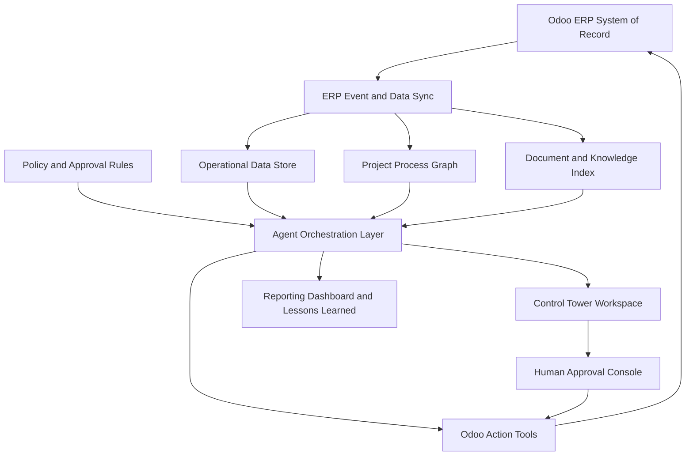

# Agentic AI Control Tower untuk Operasi ERP Berbasis Odoo

Arsitektur, Desain, dan Product Design Requirements  
Disusun dalam format laporan konsultansi profesional  
Tanggal: 2026-10-13  
Sumber: `DRAFT FLOWCHART REV FINAL 6.pdf`

## Catatan Penting

Dokumen ini ditulis dalam gaya laporan konsultansi profesional yang terinspirasi dari praktik umum executive advisory deliverables. Dokumen ini tidak menggunakan template, merek, logo, konten berhak cipta, atau metodologi rahasia milik KPMG.

## 1. Ringkasan Eksekutif

Flowchart sumber mendefinisikan model operasi perusahaan secara end-to-end, mulai dari perencanaan strategis sampai pengiriman proyek dan evaluasi akhir. Proses ini melibatkan BOD/pemegang saham, perencanaan perusahaan, pemasaran dan penjualan, legal, manajemen proyek, produksi, desain, penjamin mutu, TI, SEWACO, rantai pasok, manajemen risiko, perbendaharaan, akuntansi, SDM, dan pembiayaan terstruktur.

Solusi yang direkomendasikan adalah Agentic AI Control Tower yang dibangun di atas ERP Odoo yang sudah ada. Odoo tetap menjadi system of record. Control tower menambahkan lapisan operasi cerdas yang memantau status proses lintas fungsi, mendeteksi exception, menyiapkan rekomendasi berbasis bukti, mengorkestrasi handoff, mendukung approval, dan menangkap lesson learned.

Business case utama bukan otomasi semata. Nilainya adalah peningkatan kontrol eksekusi pada operasi proyek yang kompleks: lebih sedikit keterlambatan handoff, disiplin project code yang lebih baik, kesiapan billing yang lebih cepat, visibilitas procurement yang lebih kuat, kontrol gate QA yang lebih tegas, visibilitas AP/AR dan cash yang lebih andal, serta loop pembelajaran dari lesson learned proyek ke perencanaan berikutnya.

## 2. Pesan Utama untuk Pimpinan

| Pesan utama | Implikasi |
|---|---|
| Flowchart adalah model operasi berbasis proyek, bukan hanya diagram proses | Control tower harus diorganisasi di sekitar project digital thread dari opportunity/tender sampai delivery dan lesson learned |
| Odoo memiliki basis transaksi, tetapi belum mencakup seluruh lapisan operational intelligence | Dibutuhkan lapisan control tower terpisah untuk process graph, exception logic, agent orchestration, dan decision evidence |
| AI harus mendukung keputusan sebelum mengeksekusi transaksi | Aksi berdampak tinggi seperti konfirmasi PO, pembayaran, invoicing, QA override, dan approval kontrak harus tetap disetujui manusia |
| Keterhubungan data adalah fondasi kritikal | Project code, WBS/CBS/PBS/BOQ, PR/PO, material issue, QA gate, invoice, payment, dan lesson learned harus terhubung secara konsisten |
| MVP harus fokus pada kontrol eksekusi harian | Mulai dari project control, supply chain, production, quality, finance, dan lessons learned sebelum ekspansi ke strategic dan tender optimization |

## 3. Interpretasi Current State

### 3.1 Fase Flowchart

Proses sumber tersusun dalam lima fase operasi:

| Fase | Tujuan bisnis | Output representatif |
|---|---|---|
| Strategic foundation and development | Menerjemahkan arahan korporasi ke kebijakan, perencanaan, kapasitas, pendanaan, dan operating guidelines | Corporate target, sales and marketing plan, production capacity, IT strategy, QA plan, supply chain policy, funding plan, accounting policy, HR plan |
| Strategic planning system creation | Menyiapkan feasibility proyek, work breakdown, cost breakdown, risk analysis, financing analysis, dan proposal | Project initiate, WBS/CBS, PBS, feasibility project/proposal, selling base price, risk analysis, financing analysis |
| Contract and project setup | Mengubah peluang komersial yang disetujui menjadi baseline proyek yang dapat dieksekusi | Contract signing, project code, project management plan, master schedule, IPP, cash flow plan, ERP project management setup |
| Pre-production | Merilis prasyarat desain, produksi, material, budget, procurement, dan payment | Production planning and work package, JO production, JO design, product data management, PR, procurement plan, PO, payment |
| Production and final evaluation | Mengeksekusi produksi, acceptance quality, billing, delivery, financial closure, dan lesson learned | Material issue, fabrication stages, HAT/SAT, progress billing, payment, P&L, delivery, final report, lessons learned |

### 3.2 Tantangan Operasi yang Terlihat

| Observasi | Dampak potensial | Respons control tower |
|---|---|---|
| Banyak langkah proses bergantung pada handoff lintas direktorat | Keterlambatan dapat terlihat terlambat, setelah berdampak pada procurement, production, atau billing | Membuat event-driven handoff monitoring dan aging alert |
| Project code menjadi pusat integritas finansial, operasional, dan reporting | Transaksi tanpa project linkage mengurangi visibilitas cost, material, QA, AP/AR, dan profitability | Menegakkan pemeriksaan kelengkapan project digital thread |
| Procurement, production, QA, finance, dan risk sangat saling bergantung | Optimasi lokal dapat menciptakan kegagalan eksekusi pada level perusahaan | Menggunakan multi-domain exception scoring dan escalation |
| Billing dan payment bergantung pada bukti operasional di hilir | Acceptance record yang hilang atau milestone kontrak yang tidak jelas menunda konversi kas | Membuat billing readiness dan payment readiness packet |
| Lesson learned muncul pada final evaluation tetapi seharusnya memengaruhi planning berikutnya | Pengetahuan dapat tertangkap terlalu lambat atau tidak diterjemahkan menjadi database update | Menangkap lesson selama eksekusi dan mengarahkannya ke database target |

## 4. Rekomendasi Desain Strategis

### 4.1 Target State yang Direkomendasikan

Bangun Agentic AI Control Tower sebagai lapisan intelligence yang governed dan terhubung ke Odoo. Target state memiliki empat kapabilitas inti:

1. Project digital thread: graph persisten yang menghubungkan strategic target, tender, contract, project code, PMP, WBS/CBS/PBS/BOQ, design, procurement, material, production, quality, finance, risk, dan lessons learned.
2. Exception management: deteksi harian, prioritisasi, ownership, SLA tracking, escalation, dan resolusi operational exception.
3. Decision intelligence: approval packet berbasis bukti untuk aksi ERP terkontrol, termasuk risk, policy, source records, dan opsi rekomendasi.
4. Learning loop: penangkapan terstruktur atas lesson proyek ke database cost, customer, vendor, material, productivity, engineering, procurement, dan planning.

### 4.2 Prinsip Desain

| Prinsip | Implikasi desain |
|---|---|
| Odoo adalah system of record | Control tower membaca, merekomendasikan, membuat draft, dan mengeskalasi; writeback yang disetujui kembali ke Odoo |
| Process state bersifat event-driven | Perubahan ERP memicu assessment agent tanpa menunggu siklus laporan manual |
| Otoritas manusia tetap dipertahankan | Transaksi berdampak tinggi membutuhkan approval berdasarkan delegation of authority matrix |
| Rekomendasi harus explainable | Setiap rekomendasi mencakup source records, dokumen, asumsi, confidence, dan risk |
| Data quality adalah control objective | Project code, work package, QA evidence, dan contract milestone link yang hilang diperlakukan sebagai exception |
| Lessons learned adalah aset operasional | Knowledge proyek ditangkap, diklasifikasi, dan diarahkan ke reusable enterprise databases |

## 5. Target Operating Model

### 5.1 Peran Control Tower dalam Operasi Harian

Control tower harus berfungsi sebagai pusat kendali operasional untuk eksekusi ERP harian. Sistem ini tidak sebaiknya diposisikan sebagai chatbot atau reporting add-on. Perannya adalah mengoordinasikan operating rhythm lintas PMT, produksi, desain, QA, supply chain, finance, risk, dan leadership.

| Lapisan operasi | Tujuan | Contoh output |
|---|---|---|
| Observe | Memantau event Odoo, dokumen, schedule, risk, inventory, QA, invoice, dan payment | Project digital thread yang diperbarui |
| Assess | Mengidentifikasi exception, missing link, variance, overdue handoff, dan kebutuhan keputusan | Exception queue dan health score |
| Recommend | Memberikan opsi tindakan berbasis bukti | Recommended owner, action, due date, evidence |
| Orchestrate | Mengarahkan task dan approval lintas direktorat | Odoo activities, approval packet, escalation note |
| Learn | Menangkap outcome dan reusable knowledge | Lesson learned dan rekomendasi database update |

### 5.2 Ritme Manajemen Harian

| Waktu | Aktivitas | Output |
|---|---|---|
| 05:00-06:00 | Sinkronisasi perubahan Odoo, refresh graph, refresh metrics dan dokumen | Operational state terkini |
| 06:00-07:00 | Agent memindai schedule, procurement, production, QA, risk, AP, AR, cash, dan data completeness | Exception yang diperingkat |
| 07:00-08:00 | Membuat daily brief berbasis role | Brief untuk executive, PMT, finance, supply chain, production, QA, dan risk |
| 08:00-10:00 | War room triage | Owner, due date, escalation, dan approval yang dikonfirmasi |
| 10:00-15:00 | Agent-assisted execution | Draft action, approval packet, evidence pack |
| 15:00-16:00 | Reforecast progress dan cash | S-curve, procurement risk, AP/AR, dan cash view yang diperbarui |
| 16:00-17:00 | Menangkap decision dan lesson | Decision log dan knowledge update |

### 5.3 View Berbasis Role

| View | Audiens | Keputusan yang didukung |
|---|---|---|
| Executive portfolio view | BOD dan direktur | Proyek mana yang mengancam target strategis, finansial, atau operasional? |
| PMT control room | PMT dan project manager | Apa yang harus diselesaikan hari ini untuk melindungi schedule, cost, quality, dan cash? |
| Project digital thread | Tim proyek lintas fungsi | Record, evidence, dan handoff apa yang terhubung ke proyek ini? |
| Supply chain cockpit | Supply chain, PMT, finance | Material, PO, supplier, atau payment mana yang mengancam produksi? |
| Production cockpit | Production, QA, PMT | Work package mana yang terblokir oleh material, labor, design, atau QA gate? |
| Finance cockpit | Treasury, accounting, PMT | Isu AP, AR, billing, payment, atau P&L mana yang perlu tindakan? |
| Approval console | Authorized approver | Keputusan apa yang diperlukan, bukti apa yang mendukung, dan apa risikonya? |
| Lessons learned workspace | PMT dan knowledge owner | Insight reusable apa yang harus memperbarui enterprise databases? |

## 6. Arsitektur Referensi

### 6.1 Gambaran Arsitektur

### 6.2 Komponen Arsitektur

| Komponen | Tujuan | Implementasi yang direkomendasikan |
|---|---|---|
| Odoo connector | Integrasi read/write dengan ERP records dan workflow | Odoo custom module menggunakan ORM jika memungkinkan; API boundary untuk komponen eksternal |
| Event log | Timeline immutable atas ERP dan process events | PostgreSQL table atau analytical schema dengan event type, model, record, actor, project code, timestamp |
| Process graph | Merepresentasikan project digital thread dan dependency lintas fungsi | Graph model atas project, WBS, PBS, BOQ, PR, PO, material, QA, invoice, payment, risk, decision, document |
| Knowledge index | Retrieval atas contract, tender document, policy, QA record, engineering document, vendor history, dan lesson | Vector index dengan role-aware retrieval dan source citation |
| Metrics store | Health indicator dan trend metrics | Project health, schedule variance, cost variance, procurement risk, QA status, AP/AR, cash |
| Rules engine | Policy, delegation of authority, threshold, dan exception rule | Configurable rules table plus deterministic workflow checks |
| Agent runtime | Mengkoordinasikan agent, tool, retry, approval, dan audit | Agent orchestrator dengan tool registry, permissioning, state machine, dan idempotency |
| Control tower UI | Workspace harian dan dashboard | Odoo backend views plus optional embedded web application |
| Audit layer | Traceability agent action dan approval | Append-only log atas context, recommendation, approval, action, dan result |

### 6.3 Alur Data

1. Record dan dokumen Odoo disinkronkan ke event log, graph, metrics store, dan knowledge index.
2. Rules dan agent mengevaluasi current state terhadap process expectation dan control threshold.
3. Exception dibuat dengan severity, owner, SLA, evidence, dan recommended action.
4. Untuk controlled action, agent menyiapkan approval packet, bukan mengeksekusi langsung.
5. Human approver meninjau evidence dan approve, reject, atau request revision.
6. Approved action ditulis kembali ke Odoo melalui controlled tools.
7. Outcome ditangkap dalam audit log dan lessons learned repository.

## 7. Desain Agentic System

### 7.1 Portfolio Agent

| Agent | Scope bisnis | Tanggung jawab inti | Level otonomi |
|---|---|---|---|
| Control Tower Orchestrator | Semua fase | Trigger agent, konsolidasi daily brief, resolve conflict, route approval | Recommend and coordinate |
| Strategy Alignment Agent | RKAP/RJPP, corporate target, integrated master schedule | Membandingkan portfolio execution dengan strategic target dan capacity constraint | Recommend |
| Tender and Proposal Agent | Project initiate, feasibility, proposal, selling base price | Validasi tender completeness, feasibility evidence, risk dan financing readiness | Recommend and draft |
| Legal and Contract Agent | Legal review, contract signing, license, obligation register | Extract obligation, identifikasi missing review, hubungkan contract ke project baseline | Recommend and draft |
| Project Control Agent | PMP, master schedule, S-curve, project management control | Monitor schedule, cost, progress, risk, dan quality variance | Recommend and draft |
| Design and Product Data Agent | Design, BOQ, PBS, maker list, JO design, product data | Validasi design release, BOQ/PBS consistency, change impact | Recommend and draft |
| Supply Chain Agent | Procurement plan, PR, PO, material, vendor, subcontracting | Deteksi material delay, lead time risk, vendor risk, PO/payment dependency | Recommend and draft |
| Production Control Agent | JO production, material issue, production stages | Monitor work package readiness, labor/material consumption, bottleneck | Recommend and draft |
| Quality Agent | QA plan, TPTR, in-process quality, HAT/SAT | Cek QA evidence, failed gate, acceptance readiness | Recommend and draft |
| Finance and Cash Agent | Budget, AP, AR, payment, billing, P&L | Monitor cash, billing readiness, payment blocker, profitability variance | Recommend and draft |
| Risk and Compliance Agent | Risk analysis, business control, compliance review | Maintain risk register, detect compliance exception, escalate risk | Recommend and draft |
| HR and Resource Agent | Human capital planning, resources, competency | Identifikasi resource gap dan competency constraint | Recommend |
| Lessons Learned Agent | Final report, databases, reporting dashboard | Tangkap lesson dan rekomendasikan database update | Recommend and draft |

### 7.2 Pola Operasi Agent

Setiap agent mengikuti pola terkontrol:

1. Observe event ERP relevan dan scheduled trigger.
2. Retrieve linked records, dokumen, policy, process graph neighbors, dan prior decision.
3. Assess variance, missing data, risk, blocker, atau approval need.
4. Menghasilkan recommendation dengan evidence dan confidence.
5. Membuat draft action atau approval packet sesuai permitted scope.
6. Mengeskalasi controlled action ke human approver yang bertanggung jawab.
7. Mencatat outcome dan learning.

### 7.3 Human-in-the-Loop Control Model

| Jenis aksi | Peran agent | Peran manusia |
|---|---|---|
| Membuat observation atau exception | Create otomatis dengan evidence | Review atau resolve |
| Membuat task/activity | Draft atau create berdasarkan configured rules | Accept, reassign, atau close |
| Update forecast atau risk narrative | Draft recommendation | Approve sebelum finalization jika material |
| Confirm PO atau vendor award | Menyiapkan decision packet | Approve dan execute |
| Release payment | Menyiapkan payment readiness packet | Approve dan execute |
| Post invoice atau progress billing | Menyiapkan billing readiness packet | Approve dan post |
| Override QA gate | Menyiapkan exception packet | Approve oleh authorized role |
| Mengubah project baseline | Menyiapkan impact analysis | Approve melalui governance |
| Sign contract atau amendment | Menyiapkan obligation dan risk analysis | Approve dan sign di luar autonomous scope |

## 8. Desain Solusi Odoo

### 8.1 Anchor Utama Odoo

| Business object | Anchor Odoo | Peran control tower |
|---|---|---|
| Corporate target dan RKAP/RJPP | Planning, budgets, analytic accounts, custom strategy model | Objective dan constraint level atas |
| Opportunity, tender, project initiate | CRM, Sales, Documents, Project | Requirement dan feasibility evidence |
| Contract | Sales order, contract/custom model, documents, approvals | Commercial obligation dan baseline trigger |
| Project code | Project, analytic account, sequence | Digital thread identifier |
| PMP, master schedule, S-curve | Project, Planning, milestones, custom baseline model | Execution baseline |
| WBS/CBS/PBS/BOQ | Project tasks, analytic tags, BOM/product, custom breakdown model | Struktur scope, cost, procurement, dan production |
| JO production dan JO design | Manufacturing/work orders atau custom job order models | Execution release dan accountability |
| PR, PO, procurement plan | Purchase, Inventory, Approvals | Akuisisi material dan service |
| Material inventory dan issue | Inventory, stock moves, lots/serials | Material availability dan consumption |
| QA records, HAT/SAT | Quality, Documents, custom acceptance models | Gate control dan acceptance evidence |
| AP, AR, progress billing, payment | Accounting, Invoicing, Payments | Cash, billing, payables, profitability |
| Lessons learned | Knowledge, Documents, custom lesson model | Reusable enterprise knowledge |

### 8.2 Minimum Custom Objects

| Object | Tujuan | Key fields |
|---|---|---|
| `control_tower.event` | Immutable event log | model, record_id, project_code, event_type, actor, timestamp |
| `control_tower.exception` | Exception lifecycle | severity, owner, SLA, status, evidence, linked_records |
| `control_tower.decision` | Decision dan approval audit | approver, authority_rule, recommendation, evidence, outcome |
| `control_tower.process_node` | Digital thread node | node_type, linked_model, linked_record, project_code, dependencies |
| `project.baseline` | Approved schedule, cost, dan cash baseline | version, effective_date, approved_by, schedule_ref, budget_ref |
| `project.risk` | Project risk register | probability, impact, mitigation, owner, status |
| `project.lesson` | Lessons learned | category, source_project, recommendation, target_database, approval_status |
| `engineering.product_data_issue` | Design dan BOQ/PBS data exception | design_ref, BOQ_ref, material_ref, severity, resolution |

### 8.3 Data Quality Controls

| Control | Severity | Contoh exception |
|---|---|---|
| Project code wajib pada execution transaction | Critical | PO ada tanpa project code |
| PR/PO terkait ke BOQ/PBS/work package jika applicable | High | Material procurement tidak dapat ditelusuri ke scope |
| Material issue terkait ke work package dan production stage | High | Material consumed tanpa production accountability |
| QA gate terkait ke design baseline dan work package | High | Production progressed tanpa inspection evidence |
| Invoice terkait ke contract milestone atau acceptance evidence | Critical | Billing prepared tanpa accepted milestone |
| Payment recommendation mencakup AP review dan cash impact | Critical | Payment release tanpa cash dan authorization evidence |
| Project closure mencakup final report dan lessons learned | Medium | Project closed tanpa reusable knowledge capture |

## 9. Product Design Requirements

### 9.1 Product Vision

Menciptakan AI-enabled ERP control tower yang memberi leadership dan PMT real-time, explainable, dan auditable view atas eksekusi proyek harian, sekaligus memungkinkan agent mendeteksi exception, menyiapkan evidence, mengoordinasikan action, dan mendukung approved ERP updates.

### 9.2 Product Goals

| Goal | Expected result |
|---|---|
| Meningkatkan visibilitas eksekusi proyek | Satu digital thread terhubung per proyek |
| Mengurangi keterlambatan lintas fungsi | Exception ownership, SLA, dan escalation |
| Mempercepat billing dan cash conversion | Billing readiness dan AR exception detection |
| Mengurangi gangguan procurement dan production | Monitoring material, PO, payment, dan vendor risk |
| Memperkuat kontrol QA dan compliance | Gate evidence dan override governance |
| Meningkatkan kualitas keputusan | Evidence-based approval packet |
| Melembagakan lessons learned | Structured knowledge update setelah dan selama proyek |

### 9.3 Functional Requirements

| ID | Requirement | Priority |
|---|---|---|
| FR-001 | Sinkronisasi core Odoo records ke event log, metrics store, knowledge index, dan process graph | Must |
| FR-002 | Membuat dan memelihara project digital thread untuk setiap project code | Must |
| FR-003 | Mendeteksi missing link di contract, project, PMP, WBS/CBS/PBS, PR/PO, material, QA, invoice, payment, risk, dan lessons learned | Must |
| FR-004 | Menghasilkan role-based daily brief untuk executive, PMT, finance, supply chain, production, QA, dan risk users | Must |
| FR-005 | Memelihara exception queue dengan severity, owner, SLA, evidence, status, dan resolution history | Must |
| FR-006 | Menyediakan project health scoring lintas schedule, cost, procurement, production, quality, risk, cash, dan data completeness | Must |
| FR-007 | Menghasilkan approval packet untuk controlled actions dengan evidence, options, risk, dan policy reference | Must |
| FR-008 | Mendeteksi procurement delay risk menggunakan need date, lead time, PO status, material availability, vendor status, dan payment blockers | Must |
| FR-009 | Mendeteksi progress billing readiness menggunakan milestone status, acceptance evidence, contract terms, dan AR status | Must |
| FR-010 | Mendeteksi AP/payment blockers yang mengancam material delivery atau subcontractor continuity | Must |
| FR-011 | Mendeteksi missing atau failed QA gates sebelum progression production stage | Must |
| FR-012 | Monitor production stages dari material issue sampai final outfitting dan HAT/SAT | Must |
| FR-013 | Membandingkan actual, committed, dan forecast cost terhadap CBS budget dan P&L | Must |
| FR-014 | Memelihara project risk register dan escalate threshold breaches | Must |
| FR-015 | Menangkap lessons learned dan merekomendasikan updates ke enterprise databases | Should |
| FR-016 | Menyediakan natural language query atas project digital thread dan evidence | Should |
| FR-017 | Mendukung scenario simulation untuk schedule, procurement, cash, dan production impact | Should |
| FR-018 | Mendukung terminologi proses Bahasa Indonesia dan English dari operating model | Should |

### 9.4 Non-Functional Requirements

| ID | Requirement | Target |
|---|---|---|
| NFR-001 | Auditability | Setiap recommendation dan action dapat ditelusuri ke record, document, rule, dan approval |
| NFR-002 | Security | Access selaras dengan atau lebih ketat dari Odoo access rights |
| NFR-003 | Latency | Critical exception detection dalam 5 menit dari ERP event relevan jika feasible |
| NFR-004 | Daily readiness | Role-based daily brief tersedia sebelum morning war room |
| NFR-005 | Resilience | Odoo operations tetap berjalan jika control tower unavailable |
| NFR-006 | Privacy | Data financial, HR, legal, dan contract terisolasi berdasarkan role |
| NFR-007 | Explainability | Recommendation mencakup evidence, assumptions, confidence, dan alternatives |
| NFR-008 | Reliability | Agent actions idempotent dan duplicate-safe |
| NFR-009 | Maintainability | Prompt, rules, tools, permissions, dan workflow versioned |
| NFR-010 | Localization | Terminologi enterprise didukung dalam Bahasa Indonesia dan English |

### 9.5 Scope MVP

MVP harus fokus pada daily project execution control, bukan full enterprise optimization.

| MVP capability | Included |
|---|---|
| Project digital thread | Contract/project code sampai PMP, procurement, production, QA, billing, finance, dan lessons |
| Odoo event capture | Project, purchase, inventory, manufacturing/work order, quality, accounting, documents |
| Daily brief | Role-based brief dan exception ranking |
| Exception queue | Procurement delay, schedule variance, QA gate missing, billing readiness, AP/AR blocker, missing project code |
| Approval packets | PO, payment, billing, QA override, baseline change |
| Lessons learned | Dukungan final report dan structured database update recommendations |

MVP agents:

- Control Tower Orchestrator.
- Project Control Agent.
- Supply Chain Agent.
- Production Control Agent.
- Quality Agent.
- Finance and Cash Agent.
- Lessons Learned Agent.

Deferred capabilities:

- Full strategic planning optimization.
- Advanced financing scenario engine.
- Advanced HR competency optimization.
- Full product breakdown dan engineering change simulation.

## 10. Exception Management Framework

### 10.1 Priority Exception Types

| Exception | Detection logic | Recommended response |
|---|---|---|
| Contract-to-project delay | Contract signed tetapi project code atau PMP belum dibuat dalam SLA | Escalate ke PMT dan finance dengan setup checklist |
| Baseline mismatch | PMP, design schedule, procurement plan, dan production plan tidak selaras | Request cross-functional baseline review |
| Procurement delay risk | Material lead time melebihi need date atau PO/payment blocked | Buat expedite plan dan cash/payment escalation |
| Budget overrun | Actual atau committed cost melebihi CBS budget atau forecast threshold | Notify PMT, finance, dan risk owner |
| QA gate missing | Stage berjalan tanpa TPTR atau inspection evidence yang wajib | Block next gate atau request exception approval |
| AP/AR cash pressure | Vendor payment block atau AR delay berdampak pada project cash flow | Escalate finance action packet |
| Billing readiness | Milestone accepted tetapi invoice atau progress billing belum disiapkan | Draft billing packet |
| Lessons missing | Project closure tanpa required knowledge updates | Buat closure checklist dan owner tasks |

### 10.2 Desain Exception Record

Setiap exception harus mencakup:

- Exception type dan severity.
- Project code dan linked digital thread nodes.
- Source records dan documents.
- Business impact.
- Recommended owner dan due date.
- Required approval, jika ada.
- Agent confidence dan assumptions.
- Resolution history dan final outcome.

## 11. Governance, Risk, dan Control

### 11.1 Controlled Actions

Sistem harus mensyaratkan human approval untuk:

- Contract signature atau amendment.
- Project code creation ketika mengikat finance atau execution baseline.
- Budget release atau reallocation.
- PO confirmation atau vendor award.
- Payment release.
- Customer invoice atau progress billing release.
- Material substitution atau design baseline change.
- QA acceptance gate override.
- Risk acceptance di atas threshold.
- Project delivery sign-off dan final closure.

### 11.2 Risk Register untuk Agentic System

| Risk | Business impact | Mitigation |
|---|---|---|
| Rekomendasi AI tidak tepat | Keputusan buruk atau transaction error | Evidence requirement, approval gate, restricted write tools |
| Data quality buruk | False alert atau missed exception | Data completeness scoring dan remediation workflow |
| Unauthorized data exposure | Compliance dan confidentiality breach | Role-aware retrieval dan Odoo access alignment |
| Over-automation | Hilangnya management control | Phased autonomy model dan prohibited autonomous actions |
| Duplicate atau noisy alerts | User fatigue | Severity scoring, idempotency, SLA-based grouping |
| Model hallucination | Recommendation tidak didukung bukti | Retrieval-grounded outputs dan source traceability |
| Workflow mismatch | Low adoption | Pilot dengan real projects dan iterative rule tuning |
| System outage | Operational dependency risk | Odoo tetap system of record; control tower degrade gracefully |

### 11.3 Audit Requirements

Setiap recommendation atau action dari agent harus menyimpan:

- Triggering event.
- Agent name dan version.
- Input records dan documents.
- Rules dan policies yang digunakan.
- Recommendation dan alternatives.
- Human approver dan decision outcome.
- Final Odoo write, jika ada.
- Timestamp dan immutable audit reference.

## 12. Implementation Roadmap

### 12.1 Phased Plan

| Phase | Duration | Objective | Key deliverables |
|---|---|---|---|
| Phase 0: Mobilize and assess | 2-4 minggu | Konfirmasi Odoo landscape, data readiness, process ownership, dan MVP scope | Process-to-Odoo mapping, data assessment, authority matrix, pilot project selection |
| Phase 1: Foundation | 4-6 minggu | Membangun fondasi data, event, graph, dan exception | Event log, project digital thread, exception model, audit log, first dashboard |
| Phase 2: MVP agents | 6-8 minggu | Implementasi execution control agents dan daily brief | PMT, supply chain, production, QA, finance, lessons agents; daily briefs; approval packets |
| Phase 3: Controlled writeback | 4-6 minggu | Enable governed Odoo writeback untuk approved low/medium-risk actions | Tool registry, approval workflow, idempotent writeback, monitoring |
| Phase 4: Scale and optimize | 8-12 minggu | Ekspansi ke strategy, tender, legal, design, risk, HR, dan simulation | Expanded agent catalogue, scenario simulation, enterprise lessons loop |

### 12.2 Decision Gates

| Gate | Decision question | Evidence required |
|---|---|---|
| Gate 1: MVP approval | Apakah scope fokus dan didukung data Odoo yang usable? | Data assessment, selected pilot projects, authority matrix |
| Gate 2: Pilot readiness | Apakah agent dapat mendeteksi exception dengan akurasi yang dapat diterima? | Test results, sample briefs, false positive review |
| Gate 3: Controlled writeback | Apakah approval, audit, dan idempotency sudah cukup kuat? | Audit evidence, access test, rollback procedure |
| Gate 4: Scale | Apakah adoption dan business value terbukti? | KPI movement, user feedback, exception resolution metrics |

### 12.3 30 Hari Pertama

| Minggu | Aktivitas | Output |
|---|---|---|
| Minggu 1 | Konfirmasi process scope, owners, Odoo modules, dan sample projects | Mobilization pack |
| Minggu 2 | Mapping flowchart entities ke Odoo models dan fields | Data and process mapping |
| Minggu 3 | Definisikan exception rules, authority matrix, dan dashboard needs | MVP rulebook |
| Minggu 4 | Bangun prototype digital thread dan sample daily brief | Prototype review pack |

## 13. Benefits Case dan KPI

| Benefit area | KPI | Target direction |
|---|---|---|
| Handoff performance | Average age of unresolved cross-functional handoffs | Reduce |
| Procurement reliability | Number of production-impacting material delays | Reduce |
| Billing speed | Days from acceptance evidence to progress billing | Reduce |
| Data discipline | Percentage of transactions linked to project code and work package | Increase |
| QA control | Production progressions without required QA evidence | Reduce |
| Cash visibility | Forecast accuracy for AP, AR, and project cash flow | Increase |
| Decision readiness | Time to prepare approval evidence | Reduce |
| Lessons learned reuse | Closure records converted into database updates | Increase |

## 14. Product Acceptance Criteria

MVP dianggap acceptable ketika:

- User dapat membuka satu project dan melihat contract, PMP, WBS/CBS/PBS, procurement, material, production, QA, billing, payment, risk, dan lessons records yang terhubung.
- Sistem menghasilkan daily exception list dengan evidence, owner, severity, dan SLA.
- Minimal enam priority exception types terdeteksi dari Odoo data.
- Controlled actions membutuhkan approval dan meninggalkan audit trail lengkap.
- Progress billing readiness packet dapat dibuat dari accepted milestone evidence.
- Procurement risk packet dapat dibuat dari PR/PO/material lead time/payment status.
- Project closure membuat lessons learned dan recommended database updates.

## 15. Agenda Workshop yang Direkomendasikan

1. Validasi flowchart phases, lane ownership, dan cross-directorate handoffs.
2. Konfirmasi Odoo version, modules, customizations, dan integration constraints.
3. Identifikasi sample projects untuk validasi MVP.
4. Definisikan project code, WBS/CBS/PBS/BOQ, PR/PO, QA, billing, dan payment linkage rules.
5. Sepakati enam exception types pertama dan severity thresholds.
6. Definisikan delegation of authority dan prohibited autonomous actions.
7. Sepakati format daily brief dan war room operating rhythm.
8. Konfirmasi success metrics dan decision gates.

## 16. Kesimpulan

Agentic AI Control Tower yang diusulkan harus dibangun sebagai governed operating capability, bukan standalone AI assistant. Aset intinya adalah project digital thread: graph yang terus diperbarui dan menghubungkan strategy, tender, contract, project code, PMP, schedule, WBS/CBS/PBS/BOQ, design, procurement, material, production, QA, finance, risk, dan lessons learned.

Odoo tetap menjadi transaction engine. Control tower menyediakan intelligence layer yang dibutuhkan agar operating model menjadi observable, actionable, auditable, dan continuously improving.

## Appendix A: Source Process Entity Map

| Source process term | Interpretasi control tower |
|---|---|
| Corporate Target, RKAP, RJPP | Portfolio dan strategic target baseline |
| Shooting Target | Sales/project pipeline objective |
| Project Initiate | Tender atau project intake package |
| Feasibility Project/Project Proposal | Commercial, technical, risk, dan finance readiness package |
| Harga Dasar Penjualan | Selling base price dan commercial baseline |
| Contract Signing | Transisi formal dari commercial opportunity ke execution |
| Project Code | Master digital thread identifier |
| Project Management Plan | Approved execution baseline |
| Project Scheduling/Master Schedule | Time baseline dan progress control reference |
| Plan Project and S-Curve | Baseline dan forecast performance curve |
| Production Planning and Work Package | Production execution breakdown |
| JO Production and JO Design | Internal/external work authorization |
| Product Data Management | Design, BOQ, PBS, material dan engineering data control |
| Procurement Plan | Planned acquisition dan supply schedule |
| Purchase Order Materials and Services | Committed external supply |
| Material Inventory and Material Issued | Available dan consumed material |
| In Process Quality Control | Production quality control gate |
| Acceptance Inspection, HAT and SAT | Customer atau formal acceptance evidence |
| Progress Billing | Revenue dan cash conversion trigger |
| AP Review and Control | Payable control dan payment readiness |
| AR Review and Control | Receivable control dan billing/cash visibility |
| Profit and Loss | Project financial performance |
| Project Final Report | Formal closure evidence |
| Lessons Learned | Structured knowledge update dan continuous improvement |

## Appendix B: Initial Backlog

| Epic | Initial backlog items |
|---|---|
| Odoo data mapping | Inventory models, custom fields, project code rules, analytic account rules, workflow states |
| Digital thread | Graph schema dan links lintas contract, project, procurement, production, QA, finance, risk, dan lessons |
| Event capture | Hooks untuk project, purchase, stock, manufacturing, quality, invoice, dan payment events |
| Exception engine | Missing project code, PO delay, QA missing, billing readiness, AP/AR blocker, baseline mismatch |
| Agent runtime | Orchestrator, tool registry, approval gates, audit log, idempotency |
| Daily brief | Role templates, severity ranking, evidence snippets, distribution logic |
| User experience | Control tower menu, exception queue, project digital thread view, approval console |
| Governance | Authority matrix, prohibited actions, audit report, role access |
| Pilot | Select projects, baseline KPIs, run daily war room comparison |

## Appendix C: Open Decisions

| Decision | Owner | Required input |
|---|---|---|
| Odoo deployment dan module baseline | IT dan ERP owner | Version, hosting, installed modules, custom modules |
| MVP project sample | PMT dan directors | Active pre-production, active production, completed project |
| Authority matrix | Directors, finance, risk, legal | Approval thresholds dan prohibited actions |
| Data ownership | Process owners | Owners untuk project code, WBS/CBS/PBS, BOQ, PR/PO, QA, AP/AR |
| Dashboard design | Leadership dan PMT | Daily brief format, severity thresholds, escalation rules |
| AI hosting dan security | IT dan risk | Model hosting, data residency, access controls, audit requirements |
